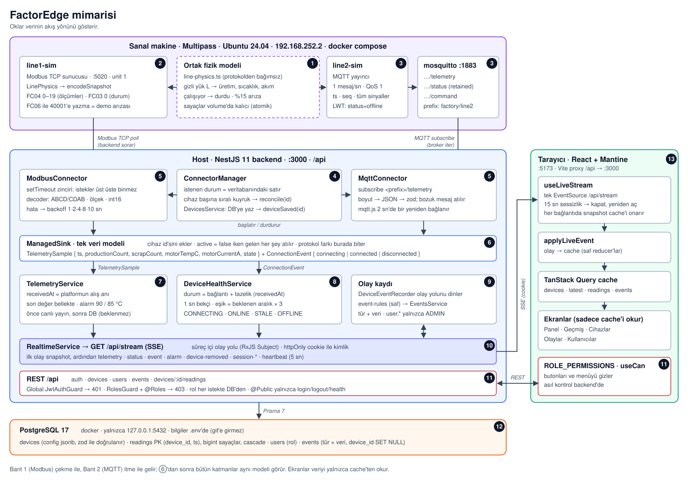

# FactorEdge: Mini Akıllı Fabrika

İki üretim bandını tek bir web arayüzünden izleyen ve yöneten platform. Bant 1 verisini **Modbus TCP**, Bant 2 **MQTT** ile veriyor. Veri kaynakları sanal makinede, platform (backend, veritabanı, arayüz) host bilgisayarda çalışıyor.

**Durum:** Zorunlu kapsamın beş maddesi çalışıyor. Bonuslardan otomatik testler, mühendis rolü, olay kaydı ve eşik alarmı var (bkz. [Bonuslar](#6-bonuslar)). **Yapılmayan bonuslar:** görüntü sınıflandırma (kamera), verimlilik göstergesi ve bağlantı koptuğunda veri tamponu. Üçü de bilinçli olarak bırakıldı; nedenleri ve nasıl yapılacakları [Bilerek yapmadıklarım](#7-bilerek-yapmadıklarım) bölümünde.

---

## 1. Kurulum ve çalıştırma

### Gereksinimler

- macOS (Apple Silicon üzerinde geliştirildi), host'ta Docker, Multipass
- Node.js 22.13+
- İsteğe bağlı test araçları: `brew install mosquitto mbpoll`

### Sanal makine (veri kaynakları)

```bash
multipass launch 24.04 --name factory --cpus 2 --memory 4G --disk 20G
multipass mount ~/projects/factoredge factory:/home/ubuntu/factoredge
multipass shell factory

# VM içinde
curl -fsSL https://get.docker.com | sudo sh
sudo usermod -aG docker $USER          # ardından çıkıp tekrar gir
sudo timedatectl set-ntp true          # VM saati kayarsa MQTT zaman damgaları da kayar
cd ~/factoredge/vm && docker compose up -d --build
```

VM'in IP adresi `multipass info factory` ile görülür. Platformda cihaz eklerken bu adres kullanılır.

> Proje klasörü `~/Desktop` altında olmamalı. macOS'un klasör koruması yüzünden VM mount edilen klasörün içini okuyamıyor.

### Platform (host)

```bash
cd platform
cp .env.example .env          # değerleri doldur; JWT_SECRET için: openssl rand -base64 48
docker compose up -d          # Postgres, yalnızca 127.0.0.1:5432

cd backend
npm install
npm run db:migrate
npm run db:seed               # .env'deki ADMIN_USERNAME / ADMIN_PASSWORD ile ilk yönetici
npm run start:dev             # http://localhost:3000/api

cd ../frontend
npm install
npm run dev                   # http://localhost:5173
```

Veritabanı boş başlar. Yönetici olarak giriş yapıp **Cihazlar → Cihaz ekle** ile iki bandı ekleyin:

| Cihaz  | Protokol   | Ayarlar                                                                                   |
| ------ | ---------- | ----------------------------------------------------------------------------------------- |
| Bant 1 | Modbus TCP | host = VM IP, port 5020, unit id 1. Register haritası dokümandaki değerlerle hazır gelir. |
| Bant 2 | MQTT       | broker `mqtt://<VM IP>:1883`, topic ön eki `factory/line2`                                |

### Testler

| Yer                 | Komut              | Test | Neyi test ediyor                                                                                                                                                                                              |
| ------------------- | ------------------ | ---- | ------------------------------------------------------------------------------------------------------------------------------------------------------------------------------------------------------------- |
| `vm/simulators`     | `npm test`         | 33   | Fizik modeli, register encoder (altın değerler), durum kaydı                                                                                                                                                  |
| `platform/backend`  | `npm test`         | 127  | Register decoder, sağlık durumu hesabı, connector yaşam döngüsü, config doğrulama, olay kuralları (hangi geçiş kaydedilir, hangisi kaydedilmez), alarm histerezisi ve eşik doğrulaması                        |
| `platform/backend`  | `npm run test:e2e` | 55   | Yetki (401/403, mühendis yetkileri), cihaz API, son admin koruması, oturum olayları, olay kaydı (rol filtresi REST'te ve canlı akışta, sayfalama, silinen cihazın olayları), alarm → olay, SSE varken kapanış |
| `platform/frontend` | `npm test`         | 153  | SSE → cache reducer'ları, biçimlendirme, form hata eşleme, oturum akışı, rol → izin tablosu, olay → Türkçe cümle, alarm şeridi ve bildirimi                                                                   |

e2e testleri ayrı bir `factoredge_test` veritabanı kullanır. Veritabanı adı `_test` ile bitmiyorsa testler başlamaz.

---

## 2. Mimari



<details>
<summary>Metin hali (terminal için)</summary>

```
┌──────────────── Sanal makine (Multipass) ────────────────┐
│                                                           │
│   line1-sim  ── Modbus TCP :5020                          │
│   line2-sim  ──publish──►  mosquitto :1883                │
│                                                           │
└───────────┬──────────────────────────────┬────────────────┘
            │ FC04 / FC03 poll             │ subscribe
┌───────────▼──────────────────────────────▼────────────────┐
│  Host: NestJS backend :3000                                │
│                                                            │
│   ConnectorManager ──► ModbusConnector / MqttConnector     │
│                            │                  │            │
│                  TelemetrySample      ConnectionEvent      │
│                            ▼                  ▼            │
│                       Telemetry         DeviceHealth       │
│                        │      │               │            │
│                PostgreSQL   Realtime ◄────────┘            │
│                              (SSE /api/stream)             │
└──────────────────────────────┬─────────────────────────────┘
                               │ REST + SSE (Vite proxy)
                  React + TanStack Query :5173
```

</details>

### Bileşenler

- **Simülatörler (`vm/simulators`):** Tek TypeScript paketi, iki giriş noktası.
  - Ortak, protokolden bağımsız bir fizik modülü var. Gizli bir "yük" değişkeni sinyalleri birbirine bağlar. Sıcaklık hedefe üstel yaklaşır. Durum makinesi: çalışıyor → durdu, bazen arıza.
  - Bant 1 bu değerleri register'lara, Bant 2 JSON mesaja çevirir.
  - Sayaçlar bir volume'da kalıcı tutulur (PLC'nin kalıcı belleği gibi). Simülatör yeniden başlayınca sayaçlar sıfırlanmaz.
- **Connector'lar:** Protokole özgü tek iş yaparlar: bağlan, oku ya da abone ol, çöz, ortak modele çevir. Veritabanını, SSE'yi ve cihaz kimliğini bilmezler.
- **ConnectorManager:** Cihaz başına bir connector tutar, ekleme, düzenleme ve silmeden sonra connector'ları DB ile uzlaştırır (karar 1).
- **Telemetry:** Okumayı kaydeder, son değeri tutar, canlı olay yayınlar.
- **DeviceHealth:** Bağlantı durumu ve veri tazeliğinden cihaz durumunu hesaplar: Bağlanıyor, Çevrimiçi, Veri yok, Bağlantı yok, Devre dışı.
- **Realtime:** SSE akışı. Bağlanınca önce tüm cihazların anlık görüntüsü (snapshot), ardından canlı olaylar.
- **Frontend:** REST için TanStack Query. SSE olayları aynı cache'i saf reducer fonksiyonlarıyla günceller. Ekranlar sadece cache'i okur, verinin hangi protokolden ya da kanaldan geldiğini bilmez.

### Kesinti davranışı

| Olay                    | Arayüzde                                                                         |
| ----------------------- | -------------------------------------------------------------------------------- |
| Bant 1 simülatörü durur | Hemen **Bağlantı yok**, son değerler soluk ve "son bilinen" olarak durur         |
| Bant 2 simülatörü durur | ~3 sn sonra **Veri yok** (broker bağlantısı sağlam, veri gelmiyor)               |
| Broker durur            | Bant 2 **Bağlantı yok**, Bant 1 etkilenmez                                       |
| Kaynak geri gelir       | Kendiliğinden **Çevrimiçi** (Modbus yeniden denemesi en fazla 10 sn)             |
| Backend durur           | Üstte "Yeniden bağlanıyor", kartlar soluk; backend gelince kendiliğinden düzelir |

---

## 3. Veri modeli

| Tablo      | Alanlar                                                                                         | Not                                                                                                                                                                                                                        |
| ---------- | ----------------------------------------------------------------------------------------------- | -------------------------------------------------------------------------------------------------------------------------------------------------------------------------------------------------------------------------- |
| `devices`  | id, name (benzersiz), protocol (`MODBUS`/`MQTT`), config (jsonb), enabled                       | `config` protokole göre farklı şekilde; uygulamada zod ile doğrulanır                                                                                                                                                      |
| `readings` | device_id, ts, received_at, production_count, scrap_count, motor_temp_c, motor_current_a, state | Birincil anahtar (device_id, ts). Cihaz silinince okumalar da silinir                                                                                                                                                      |
| `users`    | id, username (benzersiz), password_hash, role (`ADMIN`/`ENGINEER`/`VIEWER`)                     |                                                                                                                                                                                                                            |
| `events`   | id, ts, type, severity (`INFO`/`WARNING`/`CRITICAL`), device_id, user_id, data (jsonb), message | Olay metin olarak değil, type + data olarak saklanır. `data` olay anının bağlamını kopyalar (cihaz adı, işlemi yapan kullanıcı). Cihaz silinince olaylar kalır, `device_id` boşalır. `message` sadece İngilizce log satırı |

- **İki bant aynı modelde:** Her connector kendi protokolünü ortak bir okumaya çevirir: `ts, productionCount, scrapCount, motorTempC, motorCurrentA, state`. Bandın durumu Modbus'ta 0/1/2, MQTT'de metin olarak gelir; ikisi de `RUNNING`/`STOPPED`/`FAULT`'a çevrilir.
- **İki zaman damgası:** `ts` ölçüm anı (MQTT'de mesajdan, Modbus'ta okuma anı). `received_at` platformun veriyi aldığı an.
- **Sayaçlar `bigint`:** Modbus uint32 en fazla ~4,29 milyara çıkar, Postgres `integer` ~2,1 milyarda taşar.
- **Canlı bağlantı durumu veritabanında değil, bellekte:** Her saniye değişiyor ve backend yeniden başlayınca zaten baştan hesaplanıyor.

### Bant 1 register haritası nasıl okunuyor

Dokümandaki adresler 1 tabanlı geleneksel gösterim. Protokolde offset 0 tabanlı:

| Doküman     | Okuma            | Çözümleme                                                   |
| ----------- | ---------------- | ----------------------------------------------------------- |
| 30001–30002 | FC04, offset 0–1 | uint32, ABCD: `üst × 65536 + alt`                           |
| 30003–30004 | FC04, offset 2–3 | float32, CDAB: önce word'ler yer değiştirir, sonra IEEE 754 |
| 30010       | FC04, offset 9   | int16 (iki tümleyen) × 0,01                                 |
| 30020       | FC04, offset 19  | uint16                                                      |
| 40001       | FC03, offset 0   | 0 durdu · 1 çalışıyor · 2 arıza                             |

Input register'lar tek bir FC04 isteğiyle (offset 0–19) okunur.

**Encoder (simülatör) ve decoder (platform) kod paylaşmıyor.** İkisi de elle hesaplanmış aynı altın değerlerle test ediliyor:

| Değer     | Beklenen register'lar |
| --------- | --------------------- |
| 123456789 | `[1883, 52501]`       |
| 72,5 °C   | `[0, 17041]`          |
| 12,34 A   | `1234`                |
| −12,34 A  | `64302`               |

Kod paylaşsalardı, iki tarafta aynı şekilde yapılan bir hata "doğru" görünürdü.

---

## 4. MQTT topic şeması ve mesaj biçimi

| Topic                     | İçerik                                                  |
| ------------------------- | ------------------------------------------------------- |
| `factory/line2/telemetry` | Saniyede bir, tüm sinyaller tek mesajda, QoS 1          |
| `factory/line2/status`    | `online` / `offline`, retained. Last Will = `offline`   |
| `factory/line2/command`   | Demo kontrolü: `{"setState":"running\|stopped\|fault"}` |

Telemetri mesajı:

```json
{
  "ts": "2026-10-08T00:15:03.120Z",
  "seq": 1234,
  "state": "running",
  "productionCount": 5821,
  "motorTempC": 63.2,
  "motorCurrentA": 13.8,
  "scrapCount": 172
}
```

- **`ts`:** ISO 8601, UTC.
- **`seq`:** Her mesajda bir artar. Süreç başlarken 1'den başlar, yani düşmesi "simülatör yeniden başladı" demektir. Bağlantı yokken mesaj üretilmez, `seq` de artmaz. Kesinti süresi `ts` aralığından görülür.
- **Birimler alan adında** (`motorTempC`, `motorCurrentA`).
- **Tek mesajda tüm sinyaller:** Değerler aynı anın fotoğrafı olur.
- **Temiz kapanış:** Simülatör kapanırken `offline`'ı kendisi yayınlar, çünkü temiz bir DISCONNECT'te broker Last Will'i yayınlamaz. Habersiz ölümde (`kill`) Last Will devreye girer.

Platform şu an sadece `telemetry` topic'ini dinliyor. `status` için bkz. [Bilerek yapmadıklarım](#7-bilerek-yapmadıklarım).

---

## 5. Verdiğim en önemli üç karar

### 1. Connector manager istenen durumu veritabanından okuyor (reconciliation)

**Ne:** Bir cihaz eklenince, düzenlenince ya da silinince connector manager'a "bu ayarla başlat" denmiyor. Onun yerine "bu cihazı DB'deki haline getir" deniyor. Her cihazın işlemleri sıralı bir kuyrukta çalışıyor. Her işlem DB'yi yeniden okuyup connector'ı ona göre durduruyor, başlatıyor ya da kaldırıyor.

**Neden:** İki yönetici aynı cihazı aynı anda düzenlerse, DB'ye yazılma sırası ile connector'a ulaşma sırası farklı olabilir. Ayarı istekle taşısaydım connector eski ayarla, hatta silinmiş bir cihaz için çalışmaya devam edebilirdi. DB'den okuyan bir işlem kaç kez, hangi sırayla çalışırsa çalışsın sonunda gerçeği uygular. Kubernetes kontrolcülerinin çalışma mantığı da bu.

**Bedeli:** Her işlemde fazladan bir DB okuması. Bu ölçekte önemsiz.

Yan etkisi: Connector'lar sadece bir config ve bir "sink" alıyor. Yeni bir protokol eklemek; bir connector sınıfı, bir config şeması, factory’de bir satır, protokol listesine bir değer (tek satırlık migration) ve formda o protokolün alanları demek. Telemetri, sağlık, canlı akış, olay kaydı ve panel değişmiyor.

### 2. Tek veri modeli ve iki zaman damgası

**Ne:** Protokol farkı connector'da bitiyor; ondan sonraki her şey (DB, sağlık, SSE, arayüz) tek bir okuma modeli görüyor. Her okumada iki zaman var: ölçüm anı (`ts`) ve platformun alış anı (`received_at`). Cihaz sağlığı alış anına göre hesaplanıyor.

**Neden:** Cihazın saatine güvenemeyiz. Bu karar geliştirme sırasında işe yaradı: VM'in saati host'tan 3,5 dakika geri kalmıştı. Sağlığı `ts`'ye göre hesaplasaydım Bant 2 sürekli "veri yok" görünürdü. İki zaman ayrı tutulduğu için kayma görünür oldu ve sağlık durumu etkilenmedi.

**Bedeli:** Okuma başına bir kolon daha.

### 3. Yetki varsayılan olarak kapalı, rol her istekte DB'den

**Ne:**

- Kimlik doğrulama ve rol kontrolü global. Açık olması gereken uç noktalar (giriş, health) tek tek işaretleniyor. Yeni yazılan bir endpoint unutulsa bile korumalı doğar.
- Rol JWT'den değil, her istekte veritabanından okunuyor.
- Parola hash'i sorgularda hiç çekilmiyor: cevaptan silinmiyor, baştan seçilmiyor (beyaz liste).

**Neden:** Rolü düşürülen ya da silinen bir kullanıcının elindeki token, süresi dolana kadar eski yetkisiyle çalışmamalı. Aynı mantık canlı akışa da uygulandı: kullanıcı silinince ya da rolü değişince açık SSE bağlantılarına hedefli bir olay gidiyor, arayüz yenilemeden güncelleniyor.

**Bedeli:** İstek başına birincil anahtar üzerinden tek bir DB sorgusu.

---

## 6. Bonuslar

| Case'teki bonus                          | Durum                                                   |
| ---------------------------------------- | ------------------------------------------------------- |
| Görüntü sınıflandırma (kamera)           | Yapılmadı (bkz. §7)                                     |
| Üçüncü rol: Mühendis                     | Yapıldı                                                 |
| Olay kaydı                               | Yapıldı                                                 |
| Eşik alarmı                              | Yapıldı                                                 |
| Verimlilik göstergesi                    | Yapılmadı (bkz. §7)                                     |
| Bağlantı koptuğunda verinin kaybolmaması | Yapılmadı (bkz. §7); veritabanı tarafındaki zemin hazır |
| Otomatik testler                         | Yapıldı (bkz. §1, Testler)                              |

### Mühendis rolü

Üç rol var: Yönetici, Mühendis, İzleyici. Mühendis cihaz ekler ve düzenler; kullanıcıları yönetemez. Cihaz silme sadece yöneticide, çünkü geri alınamaz ve cihazın okuma geçmişini de siler. Yetki backend'de `@Roles` ile, arayüzde tek bir rol → izin tablosunda tanımlı. Mühendis admin sayılmadığı için son admin koruması değişmedi.

### Olay kaydı

**Ne:** Cihaz bağlantısının kopması ve geri gelmesi, bant arızası, sıcaklık alarmı ve yönetim işlemleri (cihaz ve kullanıcı ekleme, düzenleme, silme) kaydediliyor. Olaylar sayfası ve Panel'in altındaki "Son olaylar" canlı güncelleniyor.

- Olay metin olarak değil, tür + veri olarak saklanıyor; Türkçe cümleyi arayüz kuruyor. Veri olay anının bağlamını kopyalıyor (cihaz adı, işlemi yapan kullanıcı). Cihaz silinse ya da adı değişse bile olay anlamını koruyor.
- Hangi geçişin kaydedileceği saf fonksiyonlarda ve testli. Bağlanma aşaması, ilk açılış ve normal çalışıyor/durdu döngüsü kaydedilmiyor.
- Kullanıcı olaylarını sadece yönetici görüyor. Süzme backend'de, hem REST'te hem canlı akışta.

### Eşik alarmı

Motor sıcaklığı 90 °C'ye ulaşınca alarm açılıyor, ancak 85 °C'ye inince kapanıyor. İki eşik olduğu için eşik etrafında dalgalanan değer alarmı açıp kapatmıyor. Eşikler `.env`'den değiştirilebiliyor ve başlangıçta doğrulanıyor. Değerlendirme backend'de yapılıyor, connector'da değil. Kartta kırmızı bir şerit çıkıyor, her alarm için tek bildirim geliyor. Alarm durumu bellekte; backend yeniden başlarsa gelen veriden yeniden hesaplanıyor.

Alarm durumu, ait olduğu okumayla aynı mesajda gönderiliyor. İlk sürümde ayrı mesajlardı ve ekranda bir anlığına “tepe < anlık değer” görünüyordu.

---

## 7. Bilerek yapmadıklarım

İlk üç satır case'in yapılmayan bonusları, gerisi bilinçli olarak bırakılan sınırlar.

| Ne                                                | Neden yapmadım                                                                                                                                                                                     | Yapsam nasıl yapardım                                                                                                                                                                                                                                                    |
| ------------------------------------------------- | -------------------------------------------------------------------------------------------------------------------------------------------------------------------------------------------------- | ------------------------------------------------------------------------------------------------------------------------------------------------------------------------------------------------------------------------------------------------------------------------ |
| Görüntü sınıflandırma (kamera)                    | En pahalı bonus. Zorunlu kapsamın tamamen çalışmasını öncelikledim.                                                                                                                                | VM'de bir servis telefon akışını okur, yüz ve göz noktalarıyla (ör. MediaPipe) normal / yorgun / kişi yok ayrımını yapar, sadece sınıf + zamanı `factory/desk1/operator` topic'ine yayınlar. Platformda yeni bir connector türü. Ham görüntü VM'den çıkmaz, kaydedilmez. |
| Verimlilik göstergesi                             | Kapsam önceliği.                                                                                                                                                                                   | Mevcut telemetri akışı üzerine bir hesaplama (çalışma süresi oranı, fire oranı); alarm gibi canlı olay olarak yayınlanır.                                                                                                                                                |
| Kopukken veri tamponu                             | Kapsam önceliği.                                                                                                                                                                                   | MQTT'de QoS 1 + kalıcı oturum. Zemin hazır: (device_id, ts) birincil anahtarı ve "tekrarı atla" yazımı sayesinde yeniden gönderilen veri çift kayıt oluşturmaz, `seq` boşlukları gösterir.                                                                               |
| Platformun MQTT `status`/Last Will'i dinlemesi    | Kaynak sağlığı bağlantı + tazelikten çıkarılıyor, zorunlu kapsam için yeterli.                                                                                                                     | `status` aboneliği + bir doğrulama şeması. Böylece Bant 2 simülatörü durunca kart "Veri yok" yerine "Bağlantı yok" olurdu. Simülatör tarafı zaten hazır.                                                                                                                 |
| Değer aralığı (akla yatkınlık) kontrolü           | Decoder yalnızca çözülemeyen değerleri (NaN, sonsuz, bilinmeyen durum kodu, negatif sayaç) reddediyor. Yanlış word sırası denemesinde 320.000 °C gibi değerlerin geçip alarm tetiklediğini gördüm. | Sinyal başına bir aralık (ör. sıcaklık −40…250 °C, akım 0…100 A). Aralık dışı değer NaN gibi bir veri hatası sayılır: örnek atılır, loglanır, bağlantı koparılmaz.                                                                                                       |
| TimescaleDB                                       | Saatte cihaz başına ~3.600 satır; düz Postgres yeterli.                                                                                                                                            | Okuma tablosu (device_id, ts) yapısında, tek komutla hypertable'a çevrilebilir. Uzun aralıklar için downsampling.                                                                                                                                                        |
| Backend'den makine okunur hata kodları            | Frontend şimdilik sınırlı bir iş kuralı mesajı eşlemesi yapıyor.                                                                                                                                   | Hatalarda `LAST_ADMIN` gibi sabit kodlar; çeviri tamamen frontend'de.                                                                                                                                                                                                    |
| Parola sıfırlamada eski oturumları geçersiz kılma | Açık oturum bilgilendiriliyor ama eski token süresi dolana kadar geçerli.                                                                                                                          | Kullanıcıda token sürümü; sıfırlamada artırılır.                                                                                                                                                                                                                         |
| Çoklu backend örneği                              | Canlı olay yolu tek süreç içinde.                                                                                                                                                                  | Redis pub/sub.                                                                                                                                                                                                                                                           |
| Broker kimlik doğrulaması                         | Yerel demo ortamı.                                                                                                                                                                                 | Kullanıcı adı/parola ya da sertifika; bilgiler `.env`/secret'tan.                                                                                                                                                                                                        |
| Login hız sınırı, ileri tarihli `ts` koruması     | Kapsam dışı.                                                                                                                                                                                       | Rate limiter; `ts` alış anından belirgin şekilde ilerideyse logla ve alış anını kullan.                                                                                                                                                                                  |

------------------------------------------------- | ------------------------------------------------------------------------------ | ----------------------------------------------------------------------------------------------------------------------------------------------------------------------------------------------------------------------------------------------------------- |
| Görüntü sınıflandırma (kamera) | En pahalı bonus. Zorunlu kapsamın tamamen çalışmasını öncelikledim. | VM'de bir servis telefon akışını okur, yüz ve göz noktalarıyla (ör. MediaPipe) normal / yorgun / kişi yok ayrımını yapar, sadece sınıf + zamanı `factory/desk1/operator` topic'ine yayınlar. Platformda yeni bir connector türü. Ham görüntü VM'den çıkmaz. |
| Platformun MQTT `status`/Last Will'i dinlemesi | Kaynak sağlığı bağlantı + tazelikten çıkarılıyor, zorunlu kapsam için yeterli. | `status` aboneliği + bir doğrulama şeması. Böylece Bant 2 simülatörü durunca kart "Veri yok" yerine "Bağlantı yok" olurdu. Simülatör tarafı zaten hazır. |
| Kopukken veri tamponu | Kapsam önceliği. | MQTT'de QoS 1 + kalıcı oturum. Zemin hazır: (device_id, ts) birincil anahtarı ve "tekrarı atla" yazımı sayesinde yeniden gönderilen veri çift kayıt oluşturmaz, `seq` boşlukları gösterir. |
| Verimlilik göstergesi | Kapsam önceliği. | Mevcut telemetri akışı üzerine bir hesaplama; alarm gibi canlı olay olarak yayınlanır. |
| TimescaleDB | Saatte cihaz başına ~3.600 satır; düz Postgres yeterli. | Okuma tablosu (device_id, ts) yapısında, tek komutla hypertable'a çevrilebilir. Uzun aralıklar için downsampling. |
| Backend'den makine okunur hata kodları | Frontend şimdilik sınırlı bir iş kuralı mesajı eşlemesi yapıyor. | Hatalarda `LAST_ADMIN` gibi sabit kodlar; çeviri tamamen frontend'de. |
| Parola sıfırlamada eski oturumları geçersiz kılma | Açık oturum bilgilendiriliyor ama eski token süresi dolana kadar geçerli. | Kullanıcıda token sürümü; sıfırlamada artırılır. |
| Çoklu backend örneği | Canlı olay yolu tek süreç içinde. | Redis pub/sub. |
| Broker kimlik doğrulaması | Yerel demo ortamı. | Kullanıcı adı/parola ya da sertifika; bilgiler `.env`/secret'tan. |
| Login hız sınırı, ileri tarihli `ts` koruması | Kapsam dışı. | Rate limiter; `ts` alış anından belirgin şekilde ilerideyse logla ve alış anını kullan. |

---

## 8. Yapay zekâ kullanımı ve yanıldığı yerler

Kodun büyük kısmını Cursor içinde **Claude** ile yazdırdım. Mimari kararları, Modbus/MQTT ayrıntılarını ve her adımın planını ayrı bir sohbet asistanıyla (yine Claude) tartıştım.

Yöntemim şuydu: her adımda önce plan istedim ve onaylamadan kod yazdırmadım. Aracın "çalışıyor" demesini kanıt saymadım. Gerçek ortamda ölçmesini, yeni testin düzeltmeden önceki koda karşı **kırmızı** olduğunu göstermesini şart koştum. Aşağıdaki hatalar böyle yakalandı.

### Son admin koruması: veri doğru, cevap yanlış

İki yöneticinin aynı anda birbirini silmeye çalıştığı durum için araç Serializable transaction önerdi, çakışmayı 409'a çeviren bir eşleme yazdı. e2e testi geçiyordu.

Gerçek veritabanında hangi HTTP kodlarının döndüğünü raporlamasını istedim. 50 turluk ölçümde veri her seferinde doğruydu, son admin hiç silinmedi. Ama kaybeden istek 50 turun 49'unda **500** aldı. Sebep: çakışma hatası bazen sorgu sırasında, bazen COMMIT anında oluşuyor, ve Prisma COMMIT anındaki hatayı farklı bir türde fırlatıyor. Tek turluk test zamanlama şansıyla geçiyordu.

**Düzeltme:** İyimser kilit yerine kötümser kilit. Admin satırları `SELECT … ORDER BY id FOR UPDATE` ile kilitleniyor (sıralı kilitleme deadlock'u önlüyor). Ölçüm: 50/50 doğru 409. Test artık 10 tur dönüyor ve eski koda karşı kırmızı.

### "Kapanış hatasız" ama değilmiş

Araç, SIGTERM ile kapanışı test edip sorunsuz olduğunu söylemişti. Elle denediğimde Ctrl+C backend'i kapatmadı.

Kafa karıştırıcı olan, belirtinin başka bir hata gibi görünmesiydi. Sunucu yeni istekleri reddediyordu, ama açık SSE bağlantısından heartbeat göndermeye devam ediyordu. Arayüzdeki "bağlantı canlı mı" bekçisi heartbeat aldığı için 10 dakika boyunca "Canlı" gösterdi. Önce bekçide hata aradım; asıl sorun kapanıştaydı.

**Kök neden:** Açık SSE bağlantısı HTTP sunucusunun kapanmasını sonsuza kadar bekletiyordu. Aracın testi açık bir SSE istemcisi yokken yapılmıştı.

**Düzeltme:** Kapanışta SSE akışları tamamlanıyor, boşta kalan bağlantılar kapatılıyor, toplam süre sınırlı. Açık SSE istemcisiyle kapanışı test eden e2e testi düzeltmeden önce kırmızıydı.

### Ajan geliştirme ortamında veri değiştirdi

Arayüz doğrulaması sırasında araç, otomasyonu benim geliştirme ortamımda çalıştırdı ve yanlış bir tıklamayla Bant 1'in register ayarını değiştirip kaydetti. Kendisi fark etti, değeri geri yükledi ve hangi zaman aralığında hatalı veri yazılmış olabileceğini raporladı.

Bundan sonra kural koydum: veri değiştiren her doğrulama sadece izole bir örnekte (ayrı portlar + test veritabanı) yapılacak. Bu bir kod hatası değil, **ajan sınırı** hatası. Ve bence en öğretici olanı.

### Diğerleri, kısaca

- **Prisma 7 + Jest:** Araç "bir modül eşlemesi yeterli" dedi. Denemesinde client hiç veritabanına bağlanmamıştı. İlk gerçek e2e çalıştırmasında 18 testin hepsi düştü.
- **Grafik sayfası çöküyordu:** API curl ile doğrulanmıştı ama bileşen hiç çizilmemişti. Grafiğe her render'da yeni nesne verildiği için sonsuz güncelleme döngüsü oluşuyordu.
- **"Build temiz" ama ekran kullanılamaz:** Cihaz formu taşıyor ve ezilmişti. Ekran görüntüsüyle gösterdikten sonra araç kendi ekran görüntülerini alıp kontrol ederek düzeltti.
- **Çıkışta yönlendirme:** Cache temizleme yöntemi ekranları bilgilendirmiyordu. Sekme ancak alakasız bir yeniden çizimde giriş ekranına geçiyordu.
- **Word sırası yanlışsa ne görünür:** Sohbet asistanı, sıcaklığın word sırası yanlış girilirse ekranda ~0 °C görüneceğini söyledi. Bu sadece altın değer (72,5 °C, alt word'ü `0x0000`) için doğru. Canlı simülatörde denediğimde 80.005 ve 320.022 °C gibi değerler çıktı ve alarm tetiklendi: mantisin alt bitleri işaret ve üs olarak okunuyor. Değer aralığı kontrolünün eksik olduğu böyle ortaya çıktı (bkz. §7).
- **Sohbet asistanının önerileri:**
  - TypeScript 7'de kaldırılmış bir derleyici ayarı önerdi; derleyici hatasıyla fark edildi.
  - Süreç öldürmek için önerdiği `lsof` komutu backend'le birlikte frontend sunucusunu da öldürdü ve yanlış teşhise götüren bir belirti üretti.

---

## Ek: Sürüm sabitleme ve ortam notları

- **npm "latest" etiketi güvenilir değildi:**
  - NestJS 12 tamamen ESM'e geçmiş → proje CommonJS olduğu için NestJS 11 (bakımı süren `legacy` kolu)
  - `prisma` CLI'ın latest etiketi bir RC sürümünü gösteriyordu → `prisma`, `@prisma/client`, `@prisma/adapter-pg` tam olarak 7.10.0
  - TypeScript 5.9 (7, kullandığım bir çözümleme ayarını kaldırmış)
- **Mosquitto 2.x** varsayılan olarak sadece localhost'u dinliyor; config'de açıkça `listener 1883` gerekiyor.
- **modbus-serial:**
  - Varsayılan dinleme adresi `127.0.0.1`
  - Farklı unit id'ye cevap vermiyor, istemci timeout alıyor
  - `unitID: 0` "herkese cevap ver" anlamına geliyor
  - Tek register okumasında farklı bir fonksiyon çağrılıyor; ikisi de tanımlı olmalı
- **Ağ açıklığı bilinçli:** Postgres sadece `127.0.0.1`'de. Mosquitto ve Modbus VM'de `0.0.0.0`'da, çünkü host'tan erişilmeleri gerekiyor.
